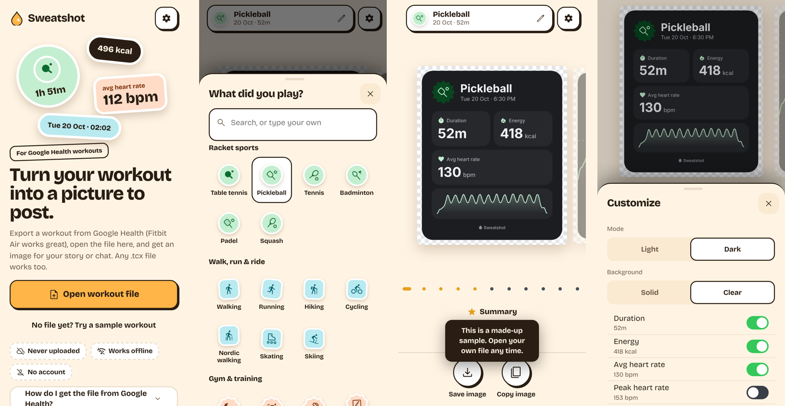
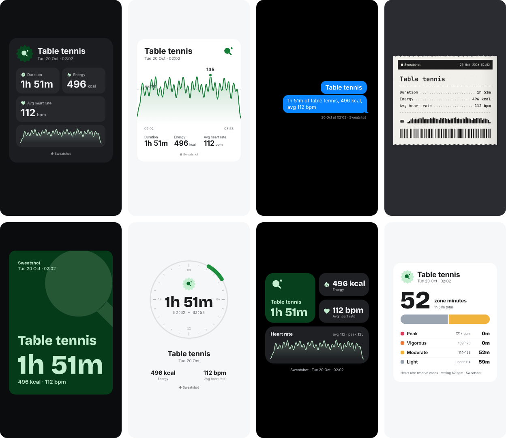

<p align="center">
  
</p>

<h1 align="center">Sweatshot</h1>

<p align="center"><b>Turn your Google Health workout into a picture you can post.</b><br>
Runs on your phone. Never uploads your file. Works offline. No account.</p>

<p align="center">
  <a href="https://sweatshot.vercel.app"></a>
</p>
<p align="center">
  
  
  
  
</p>

<p align="center"></p>

Google Health (and the Fitbit Air) records your workouts beautifully, but it can't share one as an image. It can export a `.tcx` file, though. **Sweatshot reads that file in your browser and turns it into a clean, story-ready picture in about three taps.** Pick from eleven designs, star your favourites, choose which numbers to show, and save the PNG (or copy or share it, where your browser allows). A see-through version drops straight onto your own photo.

> Not affiliated with Google or Fitbit. "Google Health" and "Fitbit" are named only to say which exports work.

---

## How it works

| Step | What happens |
| --- | --- |
| **1. Export** | In Google Health, open the workout, tap ⋯, then **Export**, and save the file to Files. |
| **2. Open** | In Sweatshot, tap **Open workout file** and pick it. Your phone reads it; nothing leaves the device. |
| **3. Pick the sport** | The file just says "Other", so tap what you did: table tennis, pickleball, a walk, the gym, 35 sports in all, or type your own. Walks and runs are pre-selected from your pace. |
| **4. Share** | Swipe through the designs, flip **Card only / Story**, tap **Customize** for more, then **Save image**. **Copy image** and **Share** also appear when your browser supports them. |

No file yet? Tap **Try a sample workout** on the home screen.

## Quick start

| Where | What to do |
| --- | --- |
| **iPhone (Safari)** | Open [the app](https://sweatshot.vercel.app) → Share → **Add to Home Screen**. After that it works offline. |
| **Android (Chrome)** | Open [the app](https://sweatshot.vercel.app) → ⋮ → **Install app** (on some phones, **Add to Home screen**). Once installed you can also **share a .tcx file straight to Sweatshot** from Files. |
| **Desktop** | Open [the app](https://sweatshot.vercel.app) and drop a `.tcx` file anywhere on the page. |

## The designs

<p align="center"></p>

| Design | What it is |
| --- | --- |
| **Summary** | Big title, your stats in tidy tiles, and your heart rate coloured by zone. |
| **Hero number** | One big number, and you pick which: time, energy, average or peak heart rate. |
| **Heart trace** | Your heart rate as one big line, coloured by zone, with the average marked. |
| **Zones** | A donut of the time you spent in each heart-rate zone. |
| **Messages** | Your workout as a text bubble. |
| **Receipt** | A shop receipt itemised by zone, with your heart rate printed as the barcode. |
| **Editorial** | Your session as a magazine cover, with cover lines written from your numbers. |
| **Sticker pill** | A compact pill to drop on any photo. |
| **Widgets** | Your stats as a home screen of phone widgets. |
| **Poster** | Bold type and a giant sport glyph, with the big number of your choice. |
| **Day dial** | When you played on a 24-hour clock, the arc coloured by how hard you worked. |

Every design comes in **light or dark**, on a **solid or see-through** background, in **Green, Blue, Purple or Mono**, and as **Card only** (the default: cropped tight to the design, best for pasting onto a story or photo) or a full **Story** (1080×1920). Card only and Story are one tap away under the preview. Star up to **five favourites** and they come first (starring a sixth swaps out your oldest).

**Numbers you can show:** duration, energy, average / peak / lowest heart rate, time at moderate effort or harder, distance (when the file has it, usually walks and runs) and time of day. Add where you played if you want it on the card.

## Your data

Sweatshot is a static website with **no server, no database, no analytics and no third-party requests**.

- Your file is read with JavaScript **on your device**. It is never uploaded, and it isn't stored either: close the tab and it's gone. (A file shared into the app on Android is held on the phone for a moment so the app can open it, then deleted.)
- The production build ships a **Content Security Policy** that only allows the app's own origin, so even a bug couldn't send your data anywhere.
- Only your preferences (settings, favourite designs, recent sports and how you last set up a card, plus resting heart rate, age and max heart rate if you use zones) are saved, in your browser's local storage. **Settings → Reset all settings** clears them.
- After the first visit a service worker caches the app, so it **works in airplane mode**.

Don't take our word for it: the code is all here, and your browser's network panel will show no requests to any other site while you use it.

## Built for everyone

- Works on small phones (down to 320px wide), in landscape, and on desktop with drag-and-drop.
- Full keyboard support, screen-reader labels (each card preview is described, numbers included), and reduced-motion support.
- The app follows your phone's light or dark mode, or set it yourself in Settings.
- Plain-language messages: a wrong, empty or damaged file tells you exactly what to do next.

## Heart-rate zones

Zones use the **heart-rate reserve** method, following Google's approach:

| Zone | % of heart-rate reserve |
| --- | --- |
| Light | under 40 % |
| Moderate | 40–59 % |
| Vigorous | 60–84 % |
| Peak | 85 % and up |

Heart-rate reserve is *max − resting*. Cards show **real time** in each zone (zones you never reached are left out) and your **time at moderate effort or harder**. Sweatshot doesn't print Google-style "zone minutes", which count vigorous minutes twice and so can't be compared with your workout's length. Set your **resting heart rate** (Google Health tracks it) and **age** in Settings; add your max heart rate if you know it, otherwise 220 − age is used. Exact numbers can differ slightly from Google Health, which may use its own estimate of your max.

## Which files work

| Source | Works? |
| --- | --- |
| Google Health / Fitbit Air export (`.tcx`) | ✅ Made for it: heart rate, energy, duration, distance for walks and runs |
| Other apps' `.tcx` files (Garmin, Strava, Polar…) | ✅ Should work: Sweatshot reads standard TCX |
| Files with several workouts | ✅ You pick which one |
| Files without heart rate | ✅ Heart-rate designs are hidden; the rest work |
| `.gpx`, `.fit`, screenshots | ❌ No |

## Questions people ask

**Is it really free and private?** Yes. There's no account, no ads and no server to send anything to.

**Why do I have to pick the sport?** Google Health exports most workouts as "Other". Your recent sports appear first next time.

**My numbers differ by a minute or a beat from Google Health.** Durations are rounded to the nearest minute, and averages are computed from the raw samples in the file, so tiny differences can happen.

**Why does it say "Card only"?** That's the image cropped tight to the design, the easiest to paste onto an Instagram story or your own photo and resize. Tap **Story** under the preview for a full 1080×1920 image.

**Can I remove the little Sweatshot mark?** Yes: Customize → **Show Sweatshot mark**.

**Does it work on iPhone?** Yes. It's a standard web app that runs in Safari, and Add to Home Screen makes it work offline. Sharing a file *into* the app is Android-only (an iOS limitation); on iPhone, open it from inside the app.

## Development

Requires Node 20.19+ (or 22.12+).

```sh
npm ci            # install
npm run dev       # dev server on http://localhost:5173
npm test          # unit + render tests (Vitest, @napi-rs/canvas)
npm run build     # type-check and build to dist/
npm run preview   # serve the production build (service worker included)
```

- `npm run fixtures` regenerates the synthetic TCX files in `tests/fixtures/`.
- `npm run icons` regenerates the app icons in `public/` from the heart mark.
- `SWEATSHOT_PREVIEW=1 npm test` writes every rendered card to `tests/output/` so you can look at them.
- Real exports for local testing go in `tests/fixtures/private/` (gitignored, never committed).

**Deploy:** it's a static site, hosted on Vercel (build `npm run build`, output `dist`). Every push to `main` goes live.

**Layout:** `src/tcx/` parses the file and derives stats, `src/render/` draws the cards with Canvas 2D (one file per design in `src/render/designs/`), `src/export/` handles share / copy / download, `src/state/` stores preferences, `src/ui/` holds the Preact screens. Design decisions are in [DECISIONS.md](DECISIONS.md).

## Feedback

Found a bug, or want a sport or design added? [Open an issue](https://github.com/thefirstparth/statshot/issues) with the steps. **Never attach a real workout file**; describe it instead.

## Copyright

© 2026 Parth Bhatia. All rights reserved. The code is public so you can see exactly what the app does with your file; it isn't open-source licensed.

Fonts are bundled from Fontsource (SIL Open Font License). Icons are Material Symbols (Apache-2.0), plus a custom table tennis glyph.

Sweatshot is an independent project, **not affiliated with, endorsed by or connected to Google or Fitbit**.
